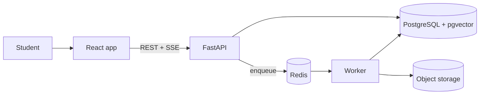

# NoteBook

> Ask your notes. Get answers you can check.

NoteBook is an AI-powered notebook for students. Add notes from many sources or write your own in a rich editor, then chat with them. Every answer is grounded in your material and links back to the exact passages it came from.

---

## Table of contents

- [Features](#features)
- [Tech stack](#tech-stack)
- [How it works](#how-it-works)
- [Project structure](#project-structure)
- [Getting started](#getting-started)
- [Configuration](#configuration)
- [Common commands](#common-commands)
- [Testing and quality](#testing-and-quality)
- [Documentation](#documentation)
- [Roadmap](#roadmap)
- [Contributing](#contributing)
- [License](#license)

---

## Features

- **Many sources, one notebook:** upload PDF and Word files, paste web pages or YouTube links, drop in plain text, or write notes in the built-in editor.
- **Rich editor:** headings, lists, tables, code, autosave, and a distraction-free focus mode.
- **Chat with your notes:** ask about a single note, a notebook, or everything.
- **Cited answers:** each answer includes citations; click one to open the note at that passage.
- **Honest by design:** if the answer isn't in your notes, the assistant says so.
- **Calm UI:** a soothing Sage theme with light and dark modes.

---

## Tech stack

| Layer | Technologies |
|---|---|
| Frontend | React, TypeScript, Vite, TanStack Query, TanStack Router, Tailwind CSS, shadcn/ui, TipTap |
| Backend | Python 3.12, uv, FastAPI, Pydantic v2, SQLAlchemy 2.0 (async), Alembic |
| Database | PostgreSQL with pgvector |
| Jobs | Redis + ARQ worker (parsing, chunking, embedding) |
| Storage | S3-compatible object storage (MinIO in development) |
| AI | Embeddings API (OpenAI or Voyage), Claude for chat, hybrid retrieval (vector + full-text) |
| Tooling | ruff, mypy, pytest, Vitest, Playwright, Docker Compose |

---

## How it works



**Ingestion:** upload or write a note, the API stores it and queues a job, and the worker then parses it to markdown, splits it into heading-aware chunks (about 500 tokens), creates embeddings, and stores them. The note shows as `ready` when done.

**Chat:** the question is rewritten using chat history, then hybrid retrieval runs (pgvector similarity plus Postgres full-text search, merged with Reciprocal Rank Fusion, optionally reranked). The top passages go into a grounded prompt, and the answer streams back over SSE with citations.

See [`docs/ARCHITECTURE.md`](docs/ARCHITECTURE.md) for the full design, data model, and API surface.

---

## Project structure

```
.
├── backend/              # FastAPI app, worker, migrations, tests
│   ├── app/
│   │   ├── api/v1/       # route handlers
│   │   ├── services/     # ingestion, retrieval, chat, llm
│   │   ├── db/           # models and sessions
│   │   └── workers/      # background tasks
│   ├── alembic/
│   └── pyproject.toml
├── frontend/             # React + TypeScript app
│   └── src/
│       ├── features/     # notes, editor, chat, auth, ...
│       ├── api/          # generated API client and hooks
│       └── components/
├── docs/                 # architecture, TODOs, agent guide
├── docker-compose.yml
└── README.md
```

---

## Getting started

### Prerequisites

- [uv](https://docs.astral.sh/uv/) and Python 3.12+
- Node.js 20+ and npm
- Docker and Docker Compose
- API keys for an embeddings provider and Anthropic (see [Configuration](#configuration))

### 1. Clone and start infrastructure

```bash
git clone https://github.com/rajan8491/notebook.git
cd notebook/
docker compose up --build -d  
```

### 2. Backend

```bash
cd backend
cp .env.example .env          # then fill in your keys
uv sync
uv run alembic upgrade head
uv run fastapi dev app/main.py
```

The API runs at `http://localhost:8000` and interactive docs are at `http://localhost:8000/docs`.

In a second terminal, start the worker:

```bash
cd backend
uv run arq app.workers.tasks.WorkerSettings
```

### 3. Frontend

```bash
cd frontend
cp .env.example .env
npm install
npm run gen:api               # generate the typed client from the running API
npm run dev
```

The app runs at `http://localhost:5173`.

### 4. Try it

Register, upload a PDF or write a note, wait for it to show `ready`, and ask a question in the chat.

---

## Configuration

Backend (`backend/.env`):

| Variable | Description |
|---|---|
| `DATABASE_URL` | Postgres connection string (async driver, e.g. `postgresql+asyncpg://...`) |
| `REDIS_URL` | Redis connection string |
| `S3_ENDPOINT_URL`, `S3_BUCKET`, `S3_ACCESS_KEY`, `S3_SECRET_KEY` | Object storage settings |
| `JWT_SECRET` | Long random secret for signing tokens |
| `EMBEDDING_PROVIDER`, `EMBEDDING_MODEL` | Embeddings provider and model name |
| `OPENAI_API_KEY` or `VOYAGE_API_KEY` | Key for the chosen embeddings provider |
| `ANTHROPIC_API_KEY` | Key for the chat model |
| `CORS_ORIGINS` | Allowed frontend origins |

Frontend (`frontend/.env`):

| Variable | Description |
|---|---|
| `VITE_API_URL` | Base URL of the backend API |

Never commit `.env` files or real keys.

> **Important:** if you change the embedding model, existing chunks must be re-embedded, because vectors from different models aren't comparable. The `embedding_model` column tracks this.

---

## Common commands

| Task | Command |
|---|---|
| Run API | `cd backend && uv run fastapi dev app/main.py` |
| Run worker | `cd backend && uv run arq app.workers.tasks.WorkerSettings` |
| New migration | `cd backend && uv run alembic revision --autogenerate -m "message"` |
| Apply migrations | `cd backend && uv run alembic upgrade head` |
| Run frontend | `cd frontend && npm run dev` |
| Regenerate API client | `cd frontend && npm run gen:api` |

---

## Testing and quality

```bash
# Backend
cd backend
uv run pytest
uv run ruff check .
uv run mypy app

# Frontend
cd frontend
npm run lint
npm run typecheck
npm run test
npm run e2e        # Playwright
```

Retrieval quality is checked with a small golden question set. Rerun the eval script after any change to chunking, retrieval, or prompts:

```bash
cd backend && uv run python -m app.evals.run
```

---

## Documentation

- [Architecture](docs/ARCHITECTURE.md)
- [Backend TODO](docs/BACKEND_TODO.md)
- [Frontend TODO](docs/FRONTEND_TODO.md)
- [Working with coding agents](rules/CODING_AGENTS_GUIDE.md)

---

## Roadmap

- [ ] Auth, notebooks, and notes CRUD
- [ ] Rich editor with autosave
- [ ] File, URL, and YouTube ingestion
- [ ] Hybrid retrieval and `/search` debug endpoint
- [ ] Streaming chat with citations
- [ ] Evals and tracing
- [ ] Flashcards and quizzes from notes
- [ ] Google sign-in
- [ ] Mobile-friendly PWA

Detailed task lists are in the TODO files under `rules/`.

---

## Contributing

1. Create a branch from `main`: `git checkout -b feature/short-description`
2. Make your change with tests. Keep PRs small and focused.
3. Make sure lint, type checks, and tests pass in both `backend/` and `frontend/`.
4. Open a pull request describing what changed and why.

Please follow the layering rules in the architecture doc (API → services → database) and always filter chunk queries by `user_id`.

---

## Security and privacy

- Note text is sent to your configured embedding and LLM providers. Tell your users.
- Please report vulnerabilities privately to `security@notebook.com` instead of opening a public issue.

---

## License

Choose a license (for example MIT) and add a `LICENSE` file. Update this section to match.
